<p align="center">
  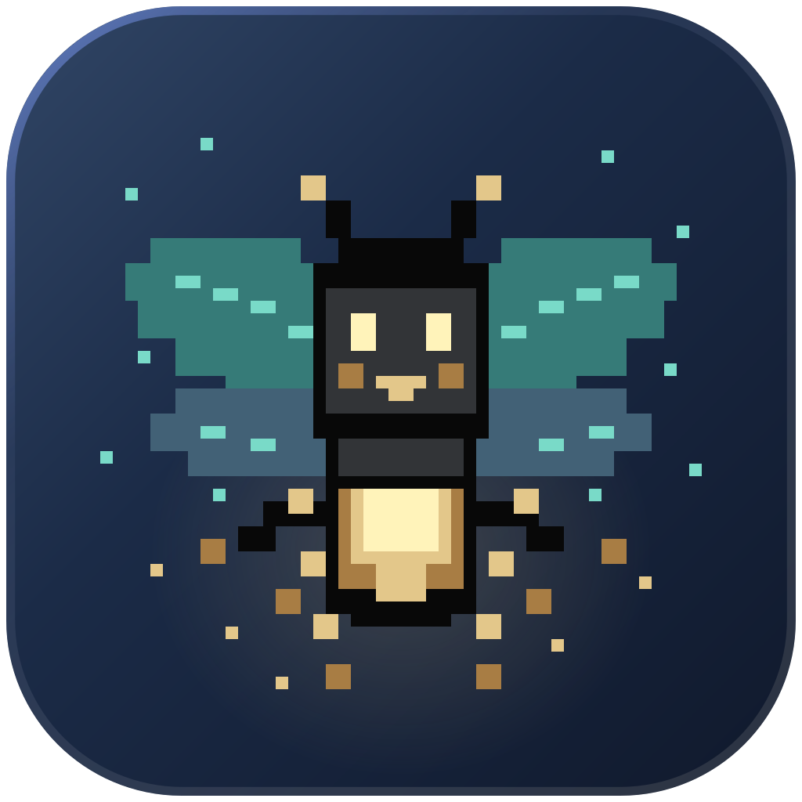
</p>

<h1 align="center">Fireflies</h1>

Fireflies is a desktop app for terminals and coding agents. Keep work in spaces, see which agents need you, and leave terminals running when you close the window.

It is a fork of [Herdr](https://github.com/herdrdev/herdr-app), the desktop app, made for macOS. It adds:

- **Nocturne**, the layout a first start shows: a 1-bit night meadow in the moonfly palette, with a sky sidebar where your agents are fireflies, a tab strip, pane headers, menus and dialogs of its own.
- **Native views in panes**: a mod can place a real macOS view in its pane. The shipped ones show web pages (with Safari's Web Inspector), PDFs, video (with a picture-in-picture player) and Quick Look previews.
- **More from panes**: splits left, up or along a tab's edge, font zoom per pane, and floating terminals.
- **Layout roles for the dialogs**, so a layout can draw the prompt, confirm, palette, peek, toasts, the welcome and the update note in its own look.

Under the name it is still Herdr: the same app home (`~/.config/herdr-app`), the same [herdr-core](https://github.com/herdrdev/herdr-core) and the same mod API. Mods written for Herdr run here.

The command is `fireflies`. Herdr's name for it, `herdr-app`, is the same program and keeps working: scripts, agent skills and setups that call it don't change. [FIREFLIES.md](FIREFLIES.md) lists what the fork changes and how it follows Herdr.

## What it looks like

These are screenshots of Fireflies with a made-up project, at zoom 1.7 (the whole window at 1.4).

**The window.** The sky sidebar lists your spaces and turns every agent into a firefly that shows its status: working, needs you, done or idle. Keep agents in the jar and dock any pane to the shelf under them. A toast says when an agent needs you. Here a shell and the editor share a tab.

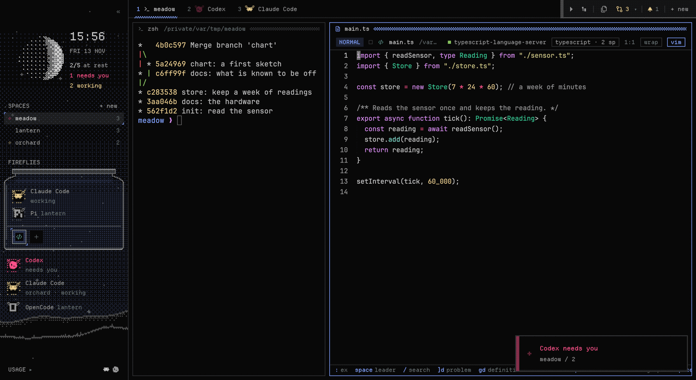

**The editor.** Tabs with file type icons, vim keys, and the language server your project uses, found on your PATH or through its `.envrc`. Here TypeScript explains a type error under the caret.

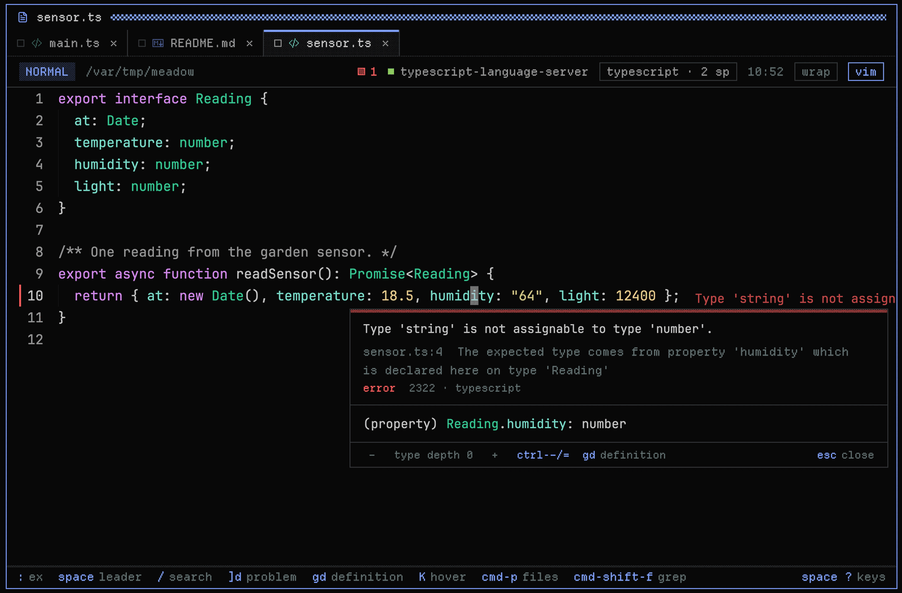

**Markdown, rendered.** The editor shows a Markdown file as text, rendered, or both side by side. Code blocks, callouts, task lists, tables and links are drawn; ticking a task writes it into the file.

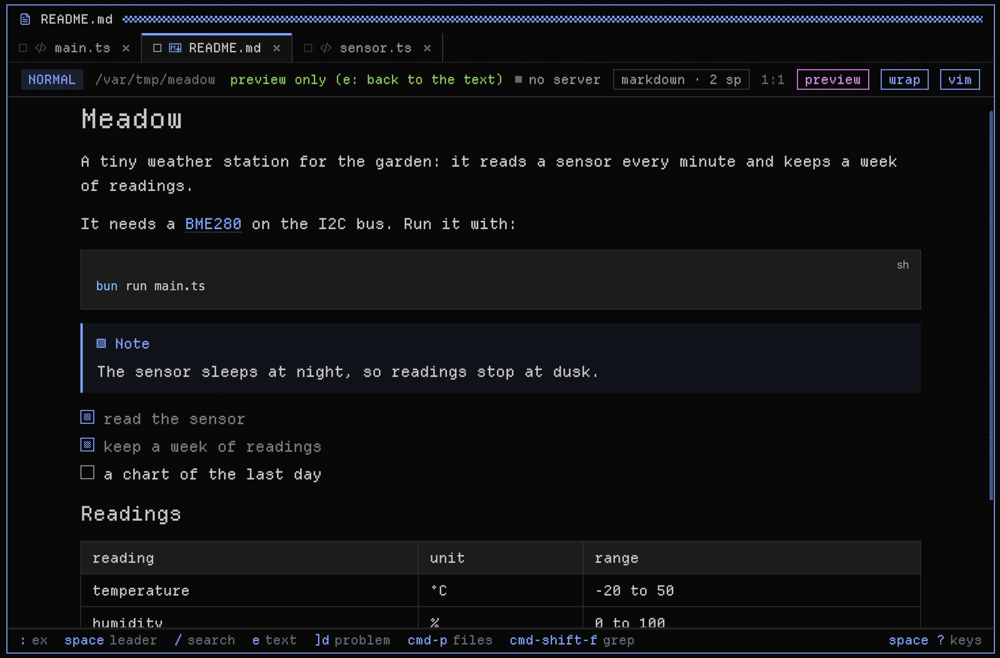

**Files and previews.** The files pane opens a preview beside it: tables for CSV files, pictures, PDFs, fonts, audio, video and patches.

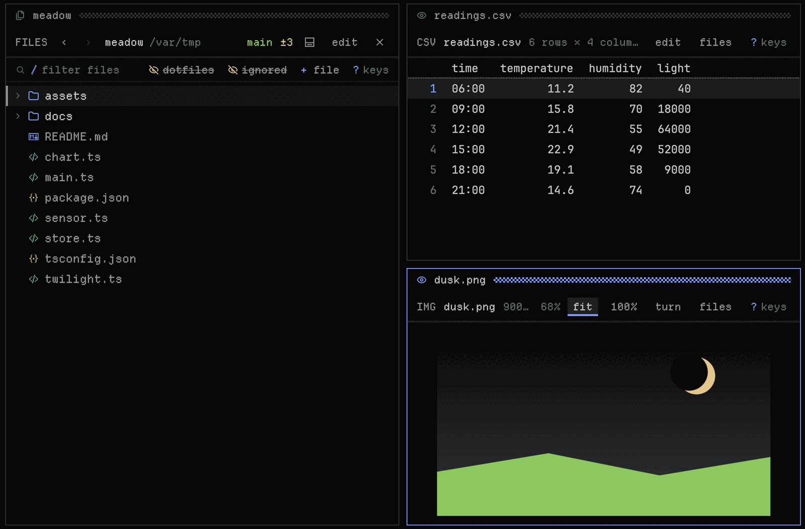

**Git.** The git window works like lazygit: stage files or single lines, switch branches, read the commit graph and review the changes.

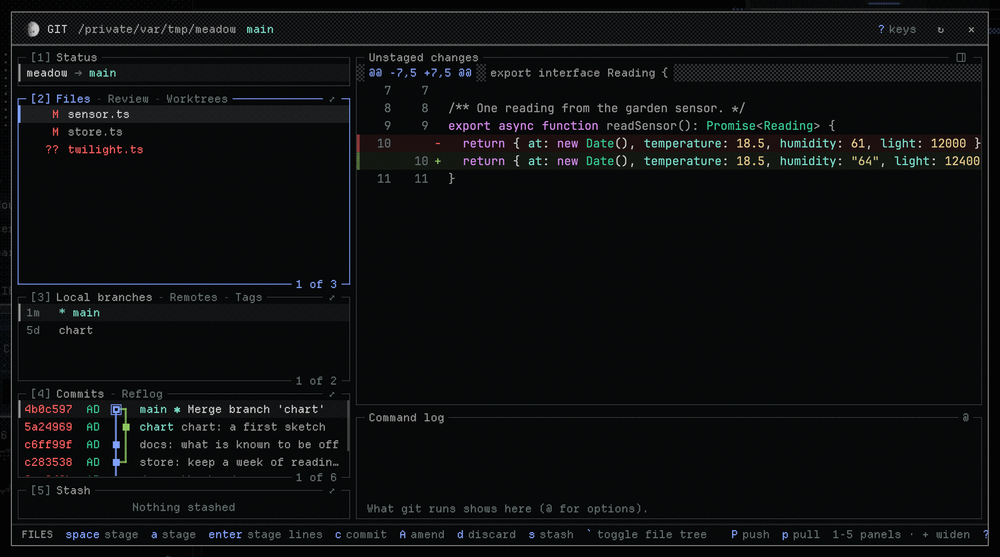

**GitHub pull requests.** The GitHub window reads the repository through `gh`: pull requests with their checks and description.

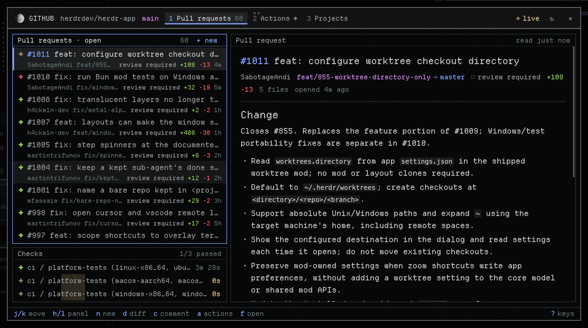

**GitHub Actions.** Its Actions tab draws a run's jobs as a graph, with the steps of a job and its log.

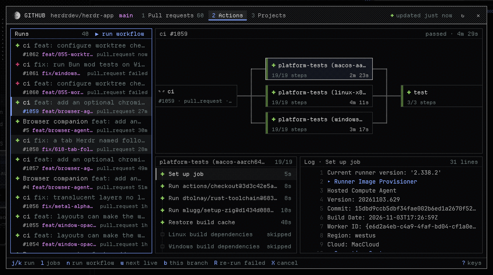

**Processes.** The processes deck shows what each terminal runs, with CPU, memory, uptime and the ports it listens on, under graphs of the machine's CPU, memory, network and disk. Sort it by any column; a row's menu acts on its process.

<p align="center">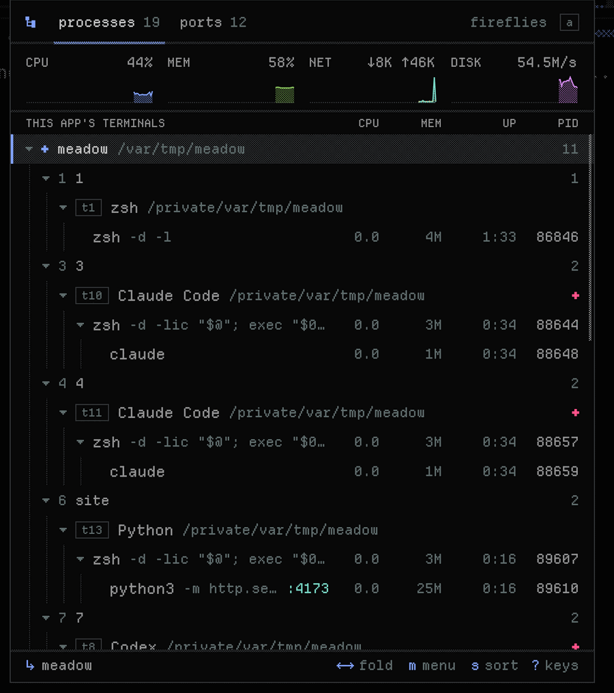</p>

**Notifications.** What your agents need from you, in one place: permission prompts and questions first.

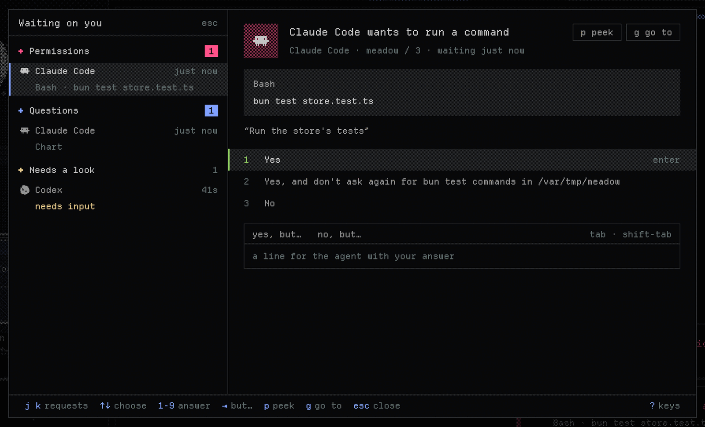

**Databases.** A window for Postgres, MySQL, SQLite and libSQL: connections (also the ones a project's `.env` names), tables and their structure, rows in a grid with a WHERE filter, SQL with syntax colours and its results, and export to CSV, JSON or SQL. A statement that changes data asks first. It opens as a window or in a pane, like Git and GitHub.

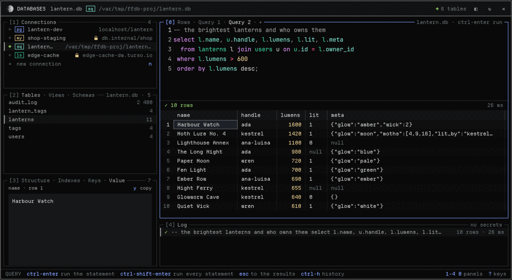

## Optional mods

Some mods are not part of Fireflies: they live in their own repositories, and you install the ones you need. Once installed, a mod shows up in the "+ new" menu and the command palette, and works with the rest of the app. More will follow.

**[fireflies-k8s](https://github.com/DwieDave/fireflies-k8s): Kubernetes and Argo CD.** Optional, and not installed with Fireflies. Contexts, namespaces and resources in a window or a pane, with a workload drawn as a graph from its ingress down to its pods, and Argo CD applications as a tree with what is out of sync. Logs and shells open as terminals in panes; a port-forward leads on to a web pane or to Databases. Every change to a cluster asks first. The pictures show a made-up cluster.

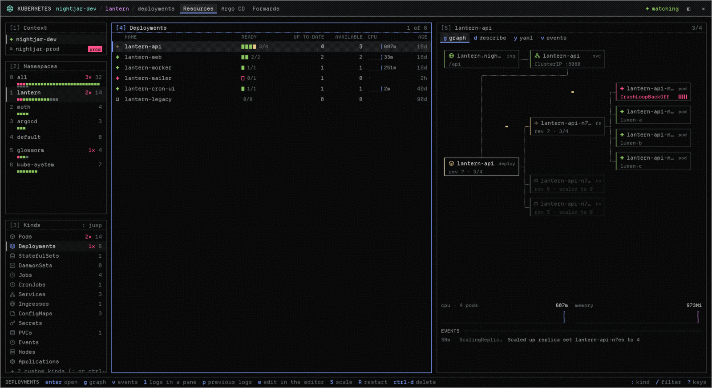

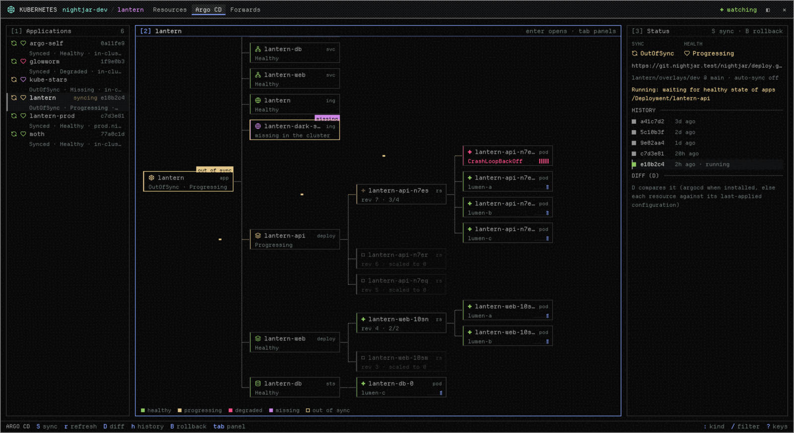

## Install

Fireflies has no release downloads yet. Build it from source on a Mac. Herdr's install scripts and its Homebrew cask install Herdr, not Fireflies.

You need [herdr-core](https://github.com/herdrdev/herdr-core). If Fireflies can't find it, its setup window offers to install it for you.

### Build from source

Clone the repository with its submodules and use Rust 1.95.0 and Zig 0.16.0, the versions in [CI](.github/workflows/ci.yml). Install [just](https://github.com/casey/just) for the recipes.

```sh
git clone --recurse-submodules https://github.com/DwieDave/fireflies.git
cd fireflies
just build
just test
just install
```

On macOS `just install` builds a release, puts the app in `~/Applications/Fireflies.app` and links both commands, `~/.local/bin/fireflies` and `~/.local/bin/herdr-app`, to it. Add that folder to your PATH. Quit and reopen the app to use a new build.

`scripts/install-fork-macos` installs into `/Applications/Fireflies.app` instead. A fork build that an earlier run put at `/Applications/Herdr.app` moves there; pin it in the Dock again. An official Herdr can stay beside it, but both apps use `~/.config/herdr-app`. To remove Herdr, uninstall it without `--zap` (zap deletes `~/.config/herdr-app`): `brew uninstall --cask herdr-app`.

The bundle keeps Herdr's bundle id, `dev.herdr.app`. A build from source never updates itself: pull and build again.

### Nix

`flake.nix` is a development shell with the language servers for this repository (rust-analyzer, the TypeScript language server, nixd, taplo) and Zig 0.16. Run `nix develop`, or `direnv allow` once to load it through `.envrc`. It doesn't build the app. To build the app with Nix, use crane as [FIREFLIES.md](FIREFLIES.md#build) describes.

## Find your work

A **space** holds work on one machine, usually in one repo. Each space has **tabs**. Split a tab into **panes** to put terminals or mod panels beside each other.

An unnamed space follows its first terminal's folder. Name a space or tab when you want a label that stays. New tabs start in the focused terminal's folder.

The sidebar brings agents from your spaces into one list, including workers started by another agent. Agents that report status show as:

- **Working:** still busy.
- **Blocked:** waiting for you.
- **Done:** finished while you were looking elsewhere.
- **Idle:** not working, or a finished agent you have looked at.

Click an agent to see it. A worker without a pane opens in **peek**, over your tab. Keep it as a tab if you want it beside your other work. Cmd-click a live terminal address such as `t7` in terminal text to peek at it. `vps/t7` names one on another machine.

The window arranges terminals. The core runs them. Closing the window leaves them running; closing a pane or tab ends its terminals. After a reboot or a core crash, kept panes get fresh shells in their last folders, not their old programs.

## Work on another machine

Add an SSH machine from Settings → Machines or the sidebar's Add machine action. Pick a host from your SSH config or type how SSH reaches it. Spaces on that machine run their terminals there, and keep running when your laptop sleeps, as long as the remote machine and core stay up.

## Make it yours

Open the command palette (Cmd+Shift+P) to find an action by name and see its key, or open Settings to change fonts, colors, sounds and other preferences. Settings → Look switches layouts: Nocturne, plus Herdr's own main, Terminals and Windows 98 layouts.

A **layout** arranges the window. **Mods** are small JavaScript programs that draw its panels, menus and dialogs. Duplicate a shipped layout or mod before changing it: your copies stay yours, and the app replaces the shipped ones on start. Save a personal layout, mod or key file and the window reloads it. A broken edit keeps the last good version and reports the error.

Change any key in `keys.json`. The [keys section](defaults/AGENTS.md#keys-keysjson) of the mod guide has the format.

[Layouts and mods](docs/mods.md) · [Commands](docs/commands.md) · [Labels](docs/labels.md)

## Privacy

Fireflies collects no usage data. Send feedback opens a prefilled GitHub issue on this repository that you review and submit yourself. Mods are trusted code, not sandboxed extensions: read [security and privacy](docs/security.md) before installing someone else's mod.

## For agents

```sh
fireflies --skill
```

This prints the agent guide for driving the window. The herdr-core skill points agents here. Use herdr-core for running and coordinating programs; use the app to change what you see.

```sh
fireflies ls
fireflies status
fireflies commands
```

The first two inspect the open window. The command list also works without one. See the [command reference](docs/commands.md) for arguments. Every example works with `herdr-app` in place of `fireflies`.

## Contributing

See [Contributing](CONTRIBUTING.md). Run `just build` and `just check` (or `cargo test --locked`) before you send a change. Documentation checks also need [Bun](https://bun.sh): `just docs-check` checks generated pages and CLI examples, and `just docs-generate` refreshes the reference pages.

To compare drawing performance between builds, run the same fixed workloads against each:

```sh
python scripts/bench.py --bin <app executable> --set spinners --seconds 20
```

The runner needs `hc` on PATH. It prints a folder with the run's settings, counters and results, then stops its private app, terminals and core. `python scripts/bench_compare.py ghostty --root <artifact folder>` compares against Ghostty on macOS.

## License

Fireflies keeps Herdr's license: see [LICENSE](LICENSE) and [THIRD-PARTY-NOTICES](THIRD-PARTY-NOTICES).
